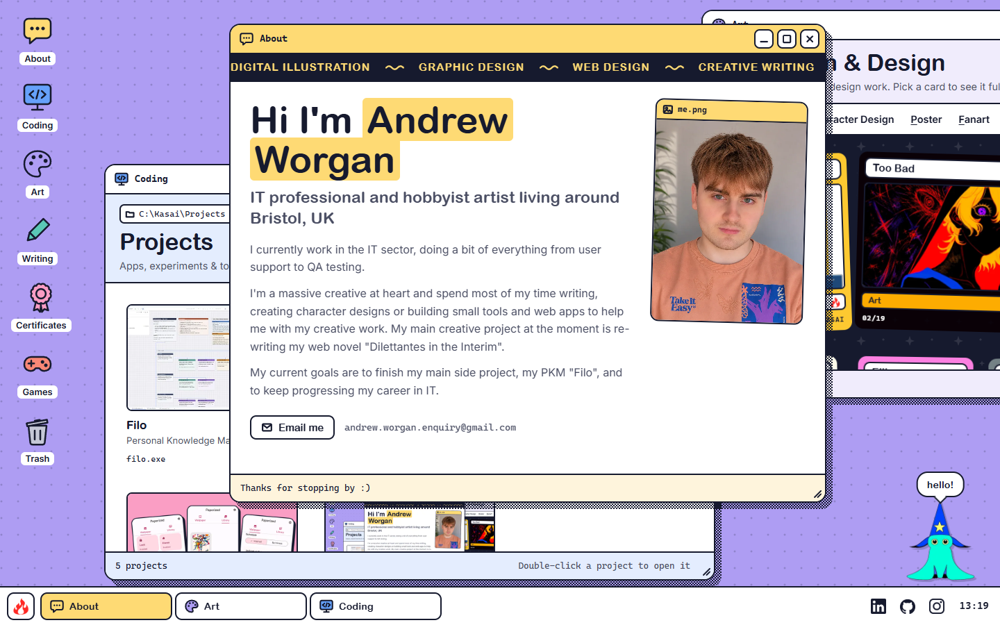
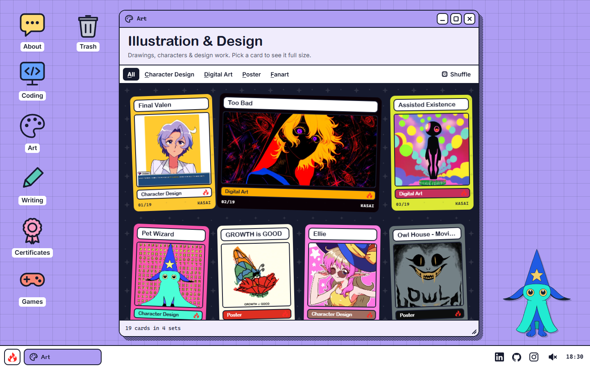
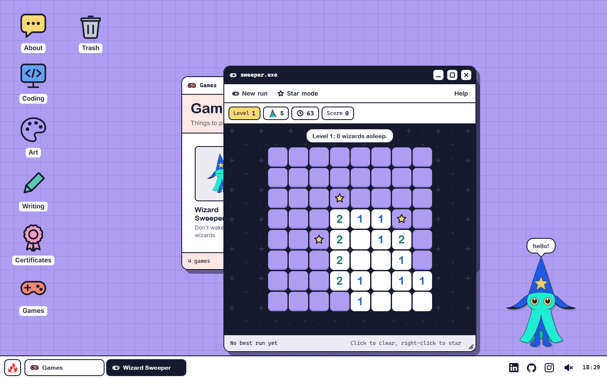
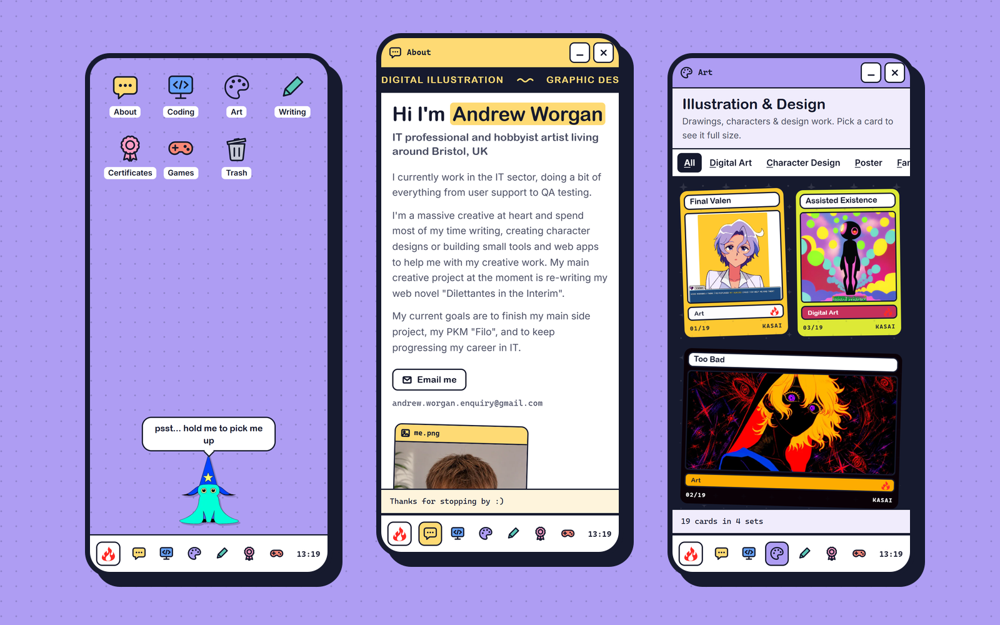

# Kasai OS

My portfolio is a little operating system. Double-click an icon on the lavender desktop and a window opens: my coding projects, my art as a binder of spell cards, my writing and certificates, three games, and a pet wizard who wanders about behind the windows. Hand-written HTML, CSS and JavaScript with no framework, hosted on Vercel.

**Live site:** https://www.andrewworgan.co.uk



<p align="center">
  
  
</p>



## What's on the desktop

- **About, Coding, Art, Writing and Certificates** each open a window that grows out of its icon. You can drag it (to the left or right edge of the screen to fill that half, or the top to fill all of it), resize it from any edge, maximise it, minimise it into the taskbar and close it. Old page addresses such as `/coding_projects` still work: they open that window.
- **My CV**, a button under the About text, opens my CV on a sheet of paper in a window of its own (or go straight to [`/cv`](https://www.andrewworgan.co.uk/cv)). Its menu bar prints it or saves it as a PDF, and only the page prints.
- **The image viewer** opens art, certificates and the Trash's old designs full size, and steps through the rest of that folder with its arrows, the arrow keys or a swipe.
- **Games** holds three roguelikes:
  - **Wizard Sweeper**: Minesweeper where the mines are sleeping wizards. Every level is a little bigger, and you pick an upgrade between levels.
  - **Not Rubbish**: someone dropped the pet wizard in the Trash. He climbs out turn by turn through the site's retired designs, bonking gremlins that mark the tiles they'll strike, with a program to install after every floor and the Empty Recycle Bin dialog waiting on the lid.
  - **Star Drop**: the pet wizard is asleep and his nightmares are creeping towards his bed. In his dream he flicks the star off his hat through a sky of pegs: every peg it pops is damage (coloured pegs count for more, and once in a blue moon a moon rises that makes a shot count ten times over), and after each shot the nightmares step closer. A run is a week of nights, picking a new star or a charm each morning, with the Bogeyman waiting on Sunday; endless runs keep going, harder every night, until his hearts run out.
- **Trash** keeps the site's retired designs, because I couldn't bring myself to delete them.
- **The pet wizard** lives on the desktop: pet him, carry him about, double-click the desktop to call him over, or ignore him until he naps.
- **Sound** is off until you switch it on with the speaker by the clock (or Sound in the Start menu). Windows blip, the wizard boops, Star Drop's pegs climb a scale as the star falls, and losing a heart in a game gives the board a shake.
- There's a boot screen, a right-click desktop menu, a wallpaper picker and a few secret codes to find.
- On a phone the desktop becomes a home screen: apps open full screen and the Back button closes them.

## How it works

- **One content file.** Every project, certificate and line of text, and everything the wizard says, lives in [`content.js`](content.js). The windows build themselves from it.
- **Drop-in art.** Add an image to `assets/art/<Category>/` and push: it turns up in the Art window as a spell card, framed in the artwork's own colours.
- **No framework.** [`kasai-os.js`](kasai-os.js) runs the desktop, windows and taskbar, [`apps.js`](apps.js) fills the windows, [`pet.js`](pet.js) is the wizard, and [`sweeper.js`](sweeper.js), [`rubbish.js`](rubbish.js) and [`stardrop.js`](stardrop.js) are the games (each only loads when it's opened). One stylesheet, [`style.css`](style.css), with flat colours throughout.
- **No sound files.** [`sound.js`](sound.js) makes every sound in the browser with Web Audio: oscillators, short envelopes and a little filtered noise, mixed through a compressor so a pile of them never clips.
- **A small build step** ([`build/build.mjs`](build/build.mjs)) runs on every Vercel deploy. It checks the scripts and `content.js` (a typo stops the deploy and keeps the live site as it was), makes WebP copies of every image at the sizes the windows need, writes the art list and versions the script and style links.
- **For everyone:** it works from the keyboard, every control is labelled for screen readers, it keeps still for anyone who prefers reduced motion, and it stays quiet until you ask for sound.

## Running locally

Requires Node.js.

```bash
npm install
npm run dev            # serve the site locally, building images on the fly
npm run build          # build the deployable site into dist/
```

## Licence

© Andrew Worgan. All rights reserved, including the artwork, photos and writing.
