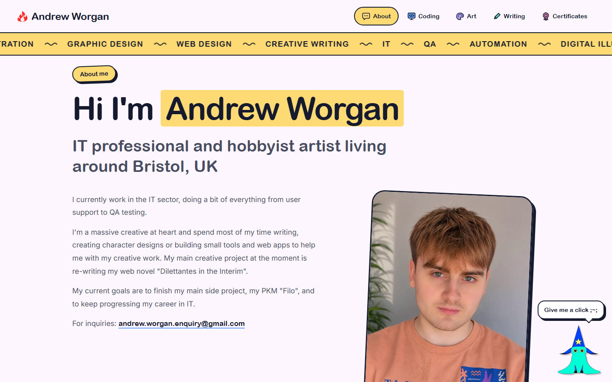
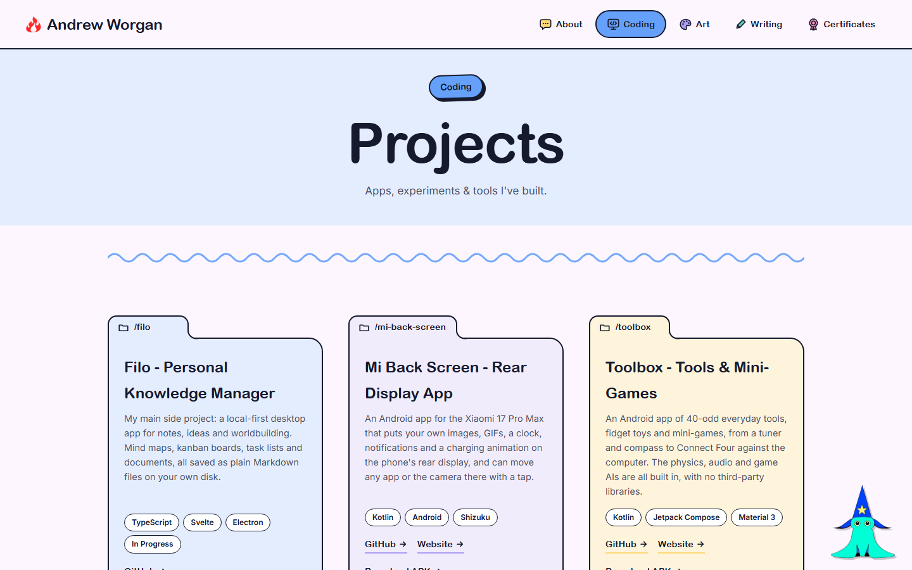

# Portfolio

My personal site: art, coding projects, writing and certificates. Hand-written HTML, CSS and JavaScript with no framework, hosted on Vercel.

**Live site:** https://portfolio-psi-azure-29.vercel.app



<p align="center">
  
  
</p>

## How it works

- **One content file.** Every project, certificate and piece of text lives in [`content.js`](content.js), and the pages build themselves from it.
- **Drop-in art gallery.** Add an image to `assets/art/<Category>/` and push: it appears on the Art page under that category, in a frame coloured from the artwork itself.
- **A small build step** ([`build/build.mjs`](build/build.mjs)) runs on every Vercel deploy. It checks `content.js` (a typo stops the deploy and keeps the live site as it was), makes WebP copies of every image at the sizes the pages need, and writes the art list.

## Running locally

Requires Node.js.

```bash
npm install
npm run dev            # serve the site locally, building images on the fly
npm run build          # build the deployable site into dist/
```

## Licence

© Andrew Worgan. All rights reserved, including the artwork, photos and writing.
